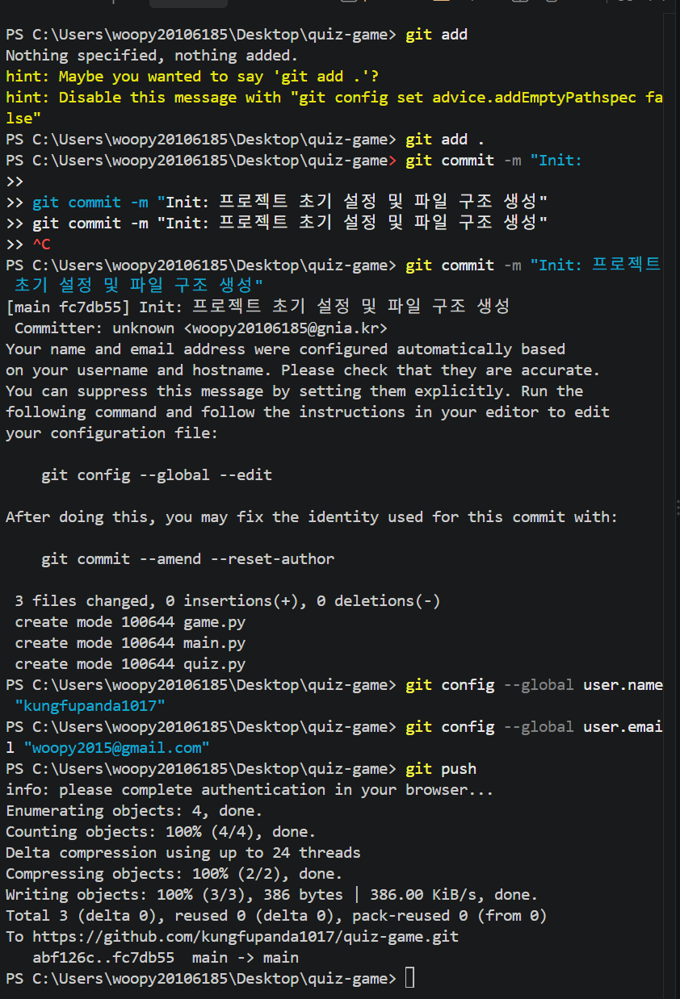
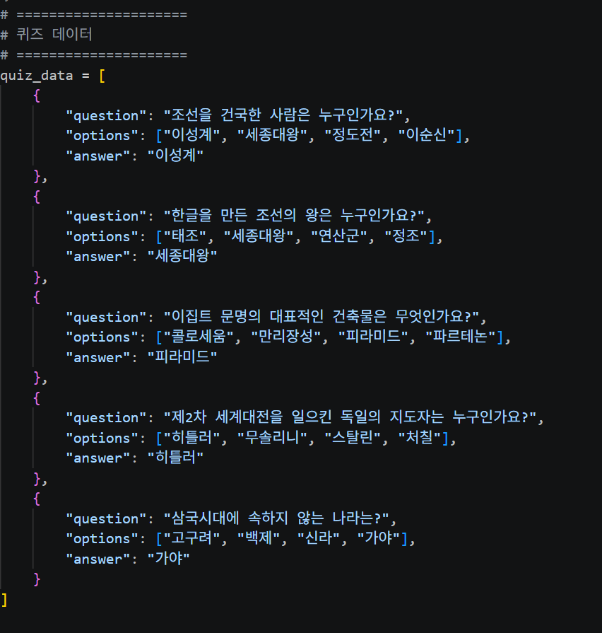
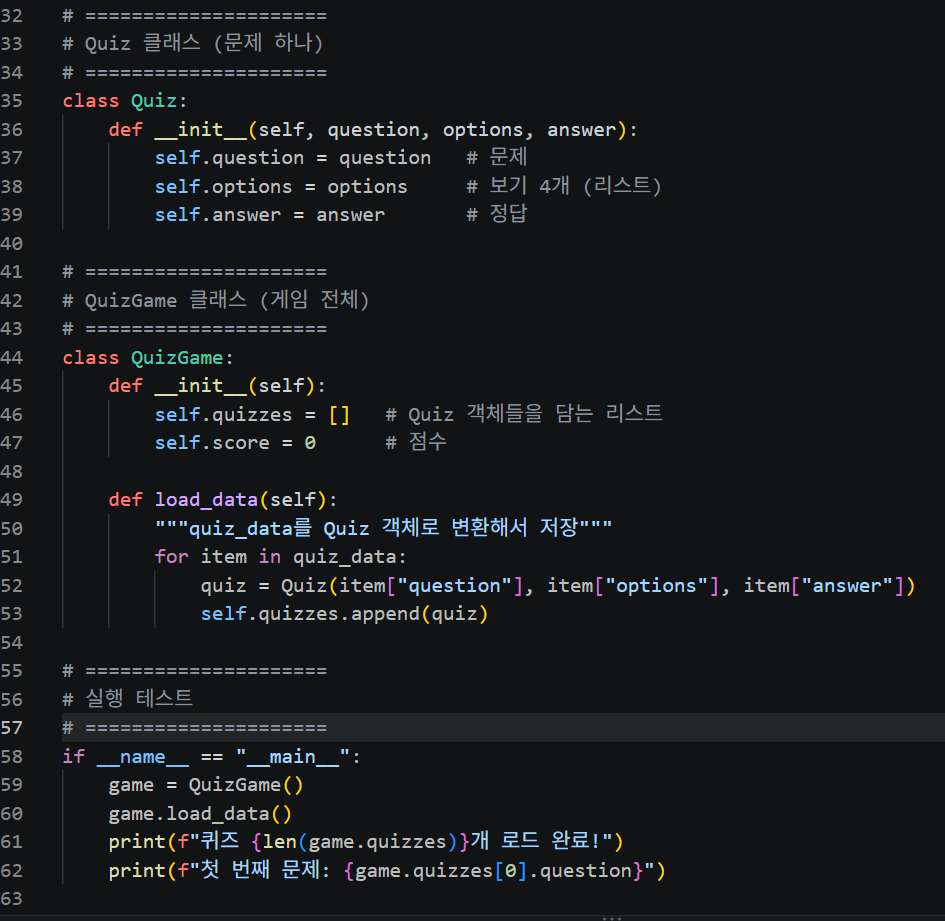
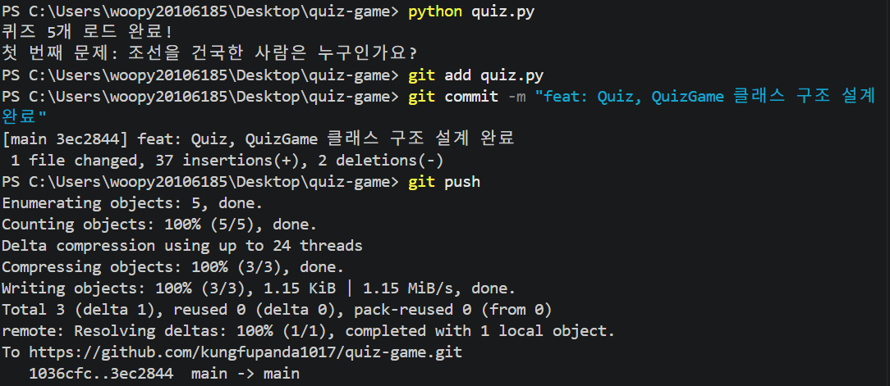

# quiz-game
# 🏛️ 역사 퀴즈 게임

## 📌 프로젝트 개요
Python으로 만든 한국사 + 세계사 객관식 퀴즈게임

## 💡 퀴즈 주제 선정 이유
- 역사는 흐른다

## ▶️ 실행 방법
```bash
python quiz.py

## 🎮 기능 목록
- [ ] 퀴즈 풀기
- [ ] 퀴즈 추가
- [ ] 퀴즈 목록 보기
- [ ] 점수 확인
- [ ] 종료

## 📁 파일 구조
(나중에 작성)

## 🗂️ 데이터 파일 설명
(나중에 작성)

---

## 🛠️ 개발 학습 및 실습 기록

### ✅ STEP 1: GitHub 저장소 생성 및 초기설정

📚 학습 내용
개념	설명
git init	로컬 저장소 초기화
git clone	원격 저장소를 내 컴퓨터로 복사
git add	변경 파일을 스테이징 영역에 추가
git commit	변경 내용을 저장소에 기록
git push	로컬 커밋을 원격(GitHub)에 업로드

🛠️ 실습 내용
- GitHub에서 quiz-game 저장소 생성
- 로컬 폴더에 git clone 완료
- README.md 초기 파일 생성
- 첫 번째 커밋 및 push 완료



### ✅ STEP 2: 퀴즈 데이터 작성

📚 학습 내용
개념	설명
JSON 형식	데이터를 저장하는 텍스트 형식
객관식 구조	question, options(4개), answer로 구성
한국사/세계사	총 5문제 작성

🛠️ 실습 내용
- quiz.py 파일 생성
- 한국사 + 세계사 혼합 문제 5개 작성
- 객관식 4지선다 형식으로 구성
- 정답 및 해설 포함
- 커밋 및 push 완료



### ✅ STEP 3: Quiz / QuizGame 클래스 설계

📚 학습 내용
개념	설명
class	객체를 만드는 설계도
__init__	클래스 초기화 메서드 (생성자)
self	클래스 자기 자신을 가리키는 변수
메서드	클래스 안에 정의된 함수

🛠️ 실습 내용
- Quiz 클래스: 문제/선택지/정답/해설 속성 정의
- QuizGame 클래스: 퀴즈 목록 관리 및 데이터 로드
- 실행 결과 확인



### ⬜ STEP 4: 메뉴 화면 구현
(진행 예정)

### ⬜ STEP 5: 퀴즈 풀기 기능 구현
(진행 예정)

### ⬜ STEP 6: 퀴즈 추가 기능 구현
(진행 예정)

### ⬜ STEP 7: 퀴즈 목록 기능 구현
(진행 예정)

### ⬜ STEP 8: 점수 확인 기능 구현
(진행 예정)

### ⬜ STEP 9: state.json 파일 저장/불러오기
(진행 예정)

### ⬜ STEP 10: 브랜치 생성 및 병합
(진행 예정)

### ⬜ STEP 11: README.md 최종 완성
(진행 예정)
