# quiz-game
# 🏛️ 역사 퀴즈 게임

## 📌 프로젝트 개요
Python으로 만든 한국사 + 세계사 객관식 퀴즈게임

## 💡 퀴즈 주제 선정 이유
- 역사는 흐른다

## ▶️ 실행 방법
```bash
python3 main.py
```
## 🎮 기능 목록
- [ ] 퀴즈 풀기
- [ ] 퀴즈 추가
- [ ] 퀴즈 목록 보기
- [ ] 점수 확인
- [ ] 종료

## 📁 파일 구조
quiz.py / game.py / main.py / state.json / README.md / images/ 

## 🗂️ 데이터 파일 설명
(나중에 작성)

---

## 🛠️ 개발 학습 및 실습 기록

### ✅ STEP 1: GitHub 저장소 생성 및 초기설정

📚 학습 내용

 명령어 | 설명 |
|--------|------|
| git init | 로컬 저장소 초기화 |
| git clone | 원격 저장소를 내 컴퓨터로 복사 |
| git add | 변경 파일을 스테이징 영역에 추가 |
| git commit | 변경 내용을 저장소에 기록 |
| git push | 로컬 커밋을 원격(GitHub)에 업로드 |

🛠️ 실습 내용

- GitHub에서 quiz-game 저장소 생성
- 로컬 폴더에 git clone 완료
- README.md 초기 파일 생성
- 첫 번째 커밋 및 push 완료
  
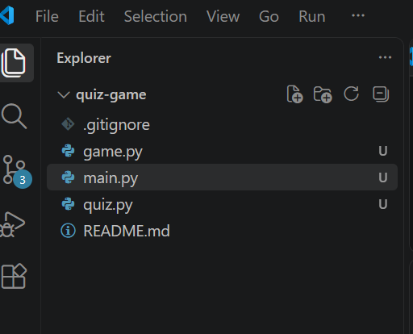


### ✅ STEP 2: 퀴즈 데이터 작성

📚 학습 내용

| 개념 | 설명 |
|------|------|
| JSON 형식 | 데이터를 저장하는 텍스트 형식 |
| 객관식 구조 | question, options(4개), answer로 구성 |
| 한국사/세계사 | 총 5문제 작성 |

🛠️ 실습 내용

- quiz.py 파일 생성
- 한국사 + 세계사 혼합 문제 5개 작성
- 객관식 4지선다 형식으로 구성
- 정답 및 해설 포함
- 커밋 및 push 완료
  


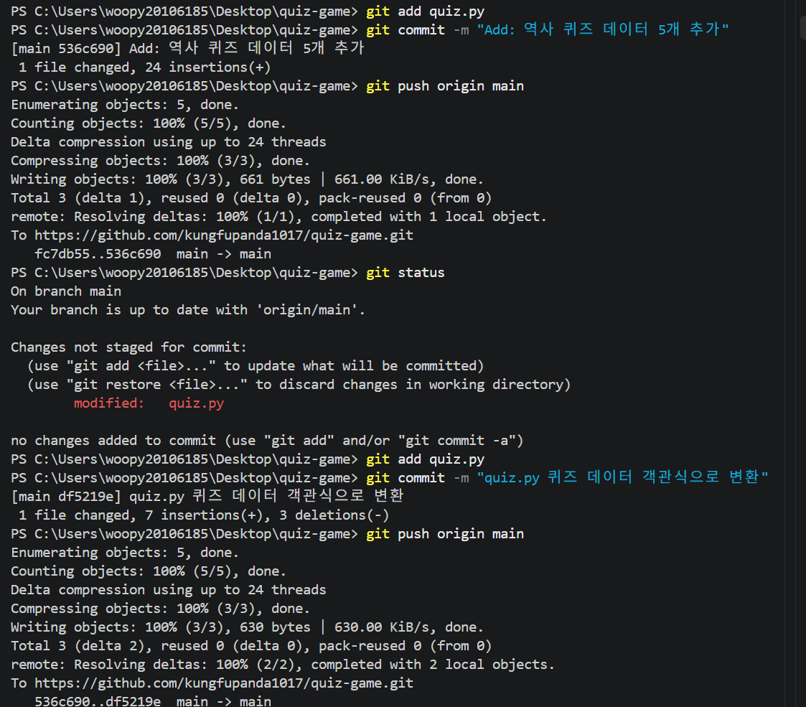

### ✅ STEP 3: Quiz / QuizGame 클래스 설계

📚 학습 내용

| 개념 | 설명 |
|------|------|
| class | 객체를 만드는 설계도 |
| __init__ | 클래스 초기화 메서드 (생성자) |
| self | 클래스 자기 자신을 가리키는 변수 |
| 메서드 | 클래스 안에 정의된 함수 |

🛠️ 실습 내용

- Quiz 클래스: 문제/선택지/정답/해설 속성 정의
- QuizGame 클래스: 퀴즈 목록 관리 및 데이터 로드
- 실행 결과 확인


### ✅ STEP 4: 메뉴 화면 구현

📚 학습 내용

#### 1. while 반복문을 활용한 메뉴 루프

| 개념 | 설명 |
|------|------|
| while True | 조건 없이 무한 반복 실행 |
| break | 반복문을 즉시 종료 |

#### 2. 조건문으로 메뉴 분기 처리

| 개념 | 설명 |
|------|------|
| if | 조건이 참일 때 실행 |
| elif | 앞의 조건이 거짓일 때 다음 조건 확인 |
| else | 모든 조건이 거짓일 때 실행 |
| input() | 사용자 입력을 받는 함수 |

#### 3. 예외 처리 (try / except)
- 숫자가 아닌 값 입력 시 오류 없이 처리
- `ValueError`를 활용한 안전한 입력 처리

🛠️ 실습 내용

#### 1. main.py 메뉴 화면 구현
- 1~5번 메뉴 선택 기능 구현
- 메뉴 선택에 따라 각 기능 호출

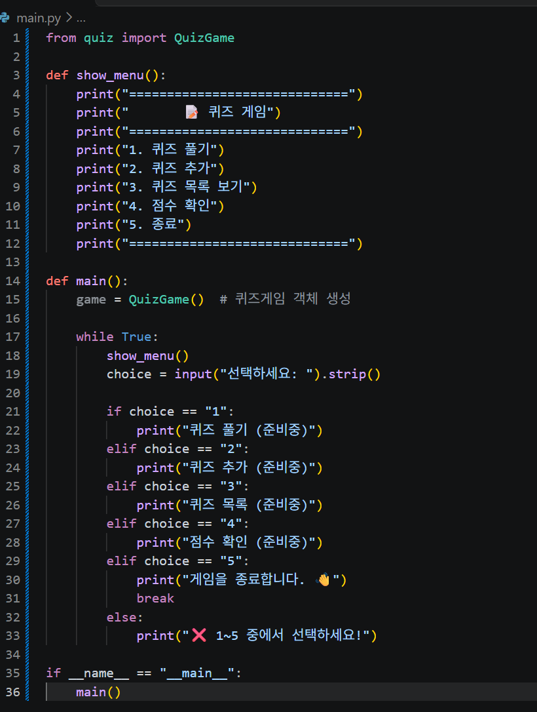
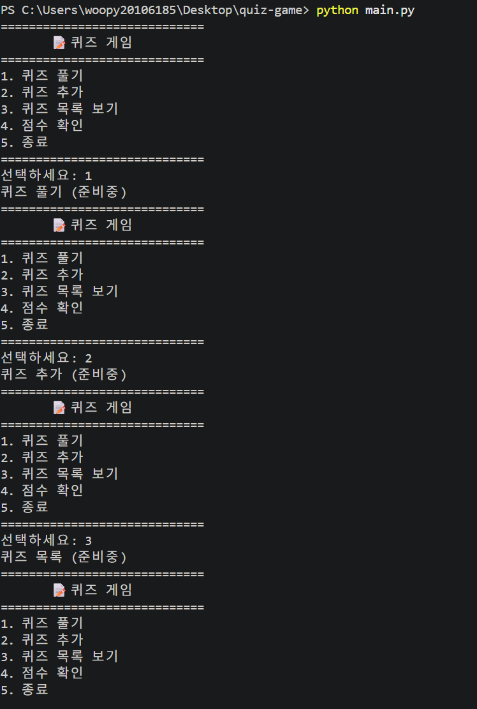
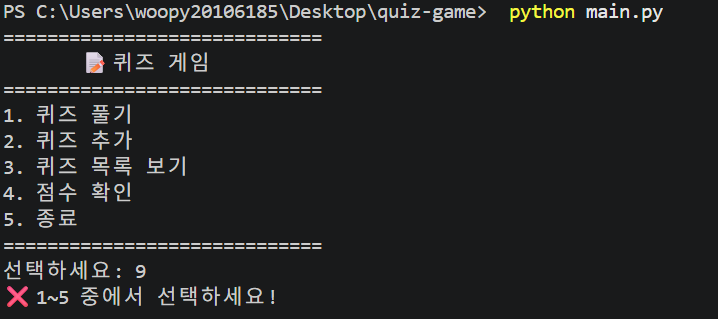

### ✅ STEP 5: 퀴즈 풀기 기능 구현
## 📚 학습 내용

| 개념 | 설명 |
|------|------|
| 리스트 인덱싱 | 번호로 리스트 항목 접근 |
| 타입 변환 | 문자열 → 정수 변환 (int()) |
| 조건문 | 정답 여부 판별 |
| isdigit() | 입력값이 숫자인지 확인 |

## 🔧 실습 내용

- QuizGame 클래스에 play() 메서드 구현

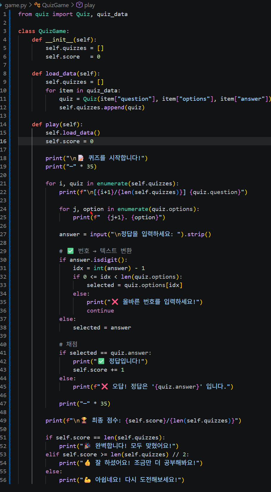

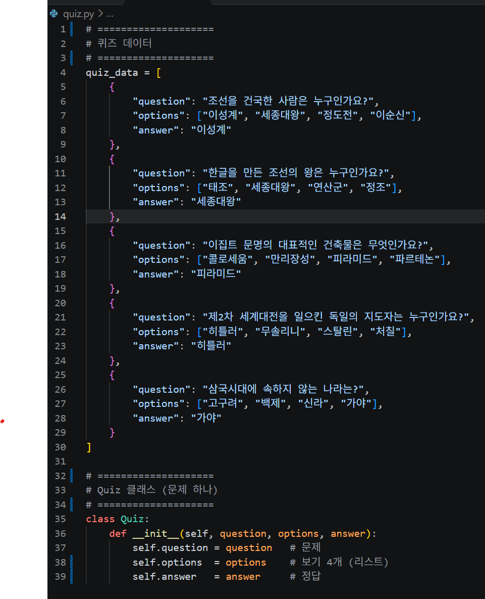

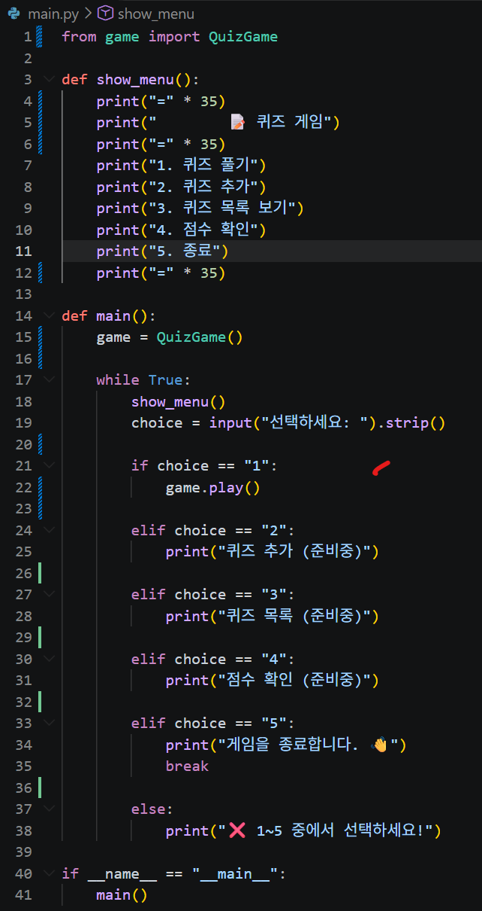

- 사용자 입력(숫자)을 선택지 텍스트로 변환 후 정답 비교

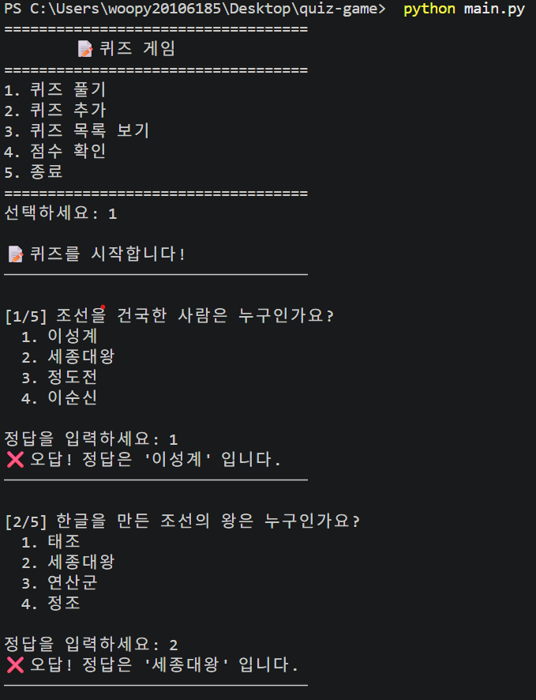

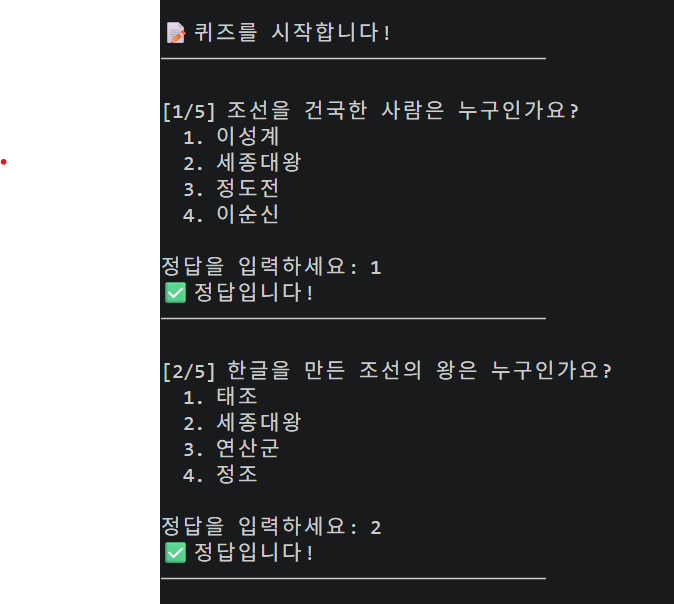

- 최종 점수 출력 및 결과 메시지 표시

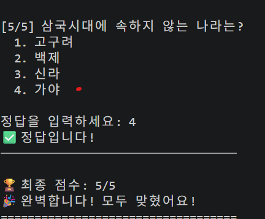

### ✅ STEP 6: 퀴즈 추가 기능 구현

📚 학습 내용

| 개념 | 설명 |
|------|------|
| 메서드 추가 | 기존 클래스에 새로운 기능 추가 |
| input() | 사용자로부터 문제/정답 입력 받기 |
| append() | 리스트에 새 항목 추가 |
| 딕셔너리 | 문제와 정답을 묶어서 저장 |

🔧 실습 내용
- QuizGame 클래스에 add_quiz() 메서드 구현

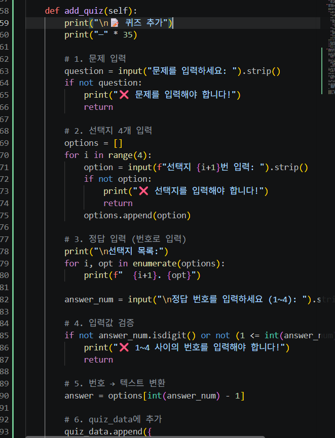

- main.py 2번 메뉴에 add_quiz() 연결


- 퀴즈 추가 실행 화면 (문제/정답 입력 → 추가 완료 메시지)

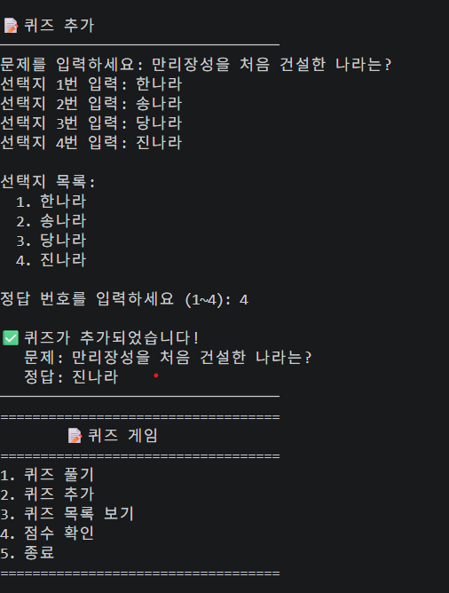

- 추가된 퀴즈가 퀴즈 목록에 반영된 것 확인

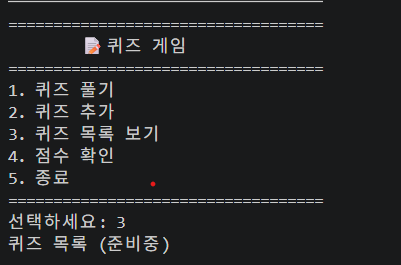

### ✅ STEP 7: 퀴즈 목록 기능 구현

📚 학습 내용

| 개념 | 설명 |
|------|------|
| 메서드 추가 | 기존 클래스에 새로운 기능 추가 |
| for문 | 리스트의 항목을 순서대로 출력 |
| enumerate() | 인덱스와 값을 함께 가져오기 |
| 딕셔너리 | 문제와 정답을 묶어서 저장 |

🔧 실습 내용
- QuizGame 클래스에 show_quiz_list() 메서드 구현

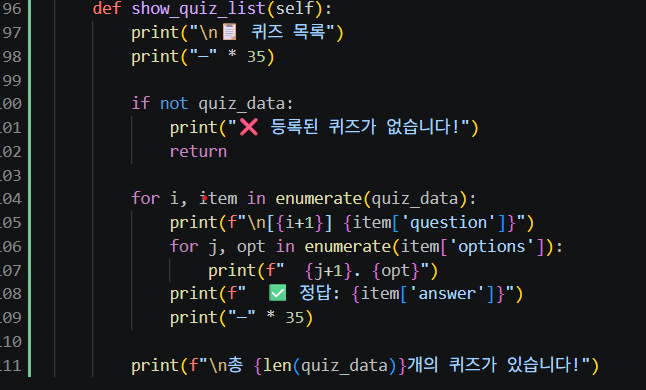

- main.py 3번 메뉴에 show_quiz_list() 연결

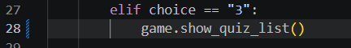

- 퀴즈 목록 실행 화면 (번호/문제/정답 출력)

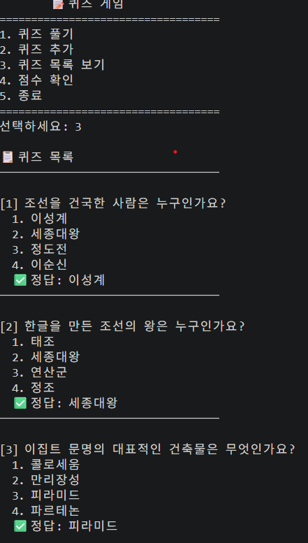

### ✅ STEP 8: 점수 확인 기능 구현

📚 학습 내용
- self.score 로 인스턴스 변수 활용
- 나눗셈으로 정답률 계산 (/)
- f-string 으로 소수점 출력 (:.1f)
- if / elif / else 로 등급 분기 처리

🔧 실습 내용
- 퀴즈를 풀지 않았을 때 안내 메시지 출력
- 맞힌 개수 / 전체 문제 수 표시
- 정답률(%) 계산 및 출력
- 등급 계산 (S / A / B / C)

### 🎖️ 등급 기준
| 등급 | 정답률 |
|------|--------|
| S 🌟 | 100%   |
| A 😊 | 80% 이상 |
| B 👍 | 60% 이상 |
| C 💪 | 60% 미만 |

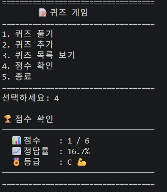

### ✅ STEP 9: state.json 파일 저장/불러오기

📚 학습 내용
- import json 으로 JSON 모듈 사용
- json.dump() 로 파일에 저장
- json.load() 로 파일에서 불러오기
- with open() 으로 파일 열기/닫기
- try / except 로 파일 없을 때 예외 처리
- ensure_ascii=False 로 한글 깨짐 방지

🔧 실습 내용
- 퀴즈 추가 시 quizzes.json 에 자동 저장
- 프로그램 시작 시 quizzes.json 자동 불러오기
- 파일이 없을 때 예외 처리 (FileNotFoundError)

### ✅ STEP 10: 브랜치 생성 및 병합

📚 학습 내용
1. 브랜치(Branch)란?
브랜치는 기존 코드를 건드리지 않고 새로운 기능을 독립적으로 개발할 수 있는 Git의 핵심 기능

3. 브랜치 주요 명령어
- 브랜치 생성 git branch feature/high-score
- 브랜치 이동 git checkout feature/high-score
- 생성 + 이동 한번에 git checkout -b feature/high-score
- 현재 브랜치 확인 git branch
- main으로 돌아오기 git checkout main
- 브랜치 합치기 (main에서 실행) git merge feature/high-score

4. 브랜치 활용 예시
main                    → 실제 서비스 중인 코드
feature/login           → 로그인 기능 개발 중
feature/dark-mode       → 다크모드 개발 중
hotfix/bug-fix          → 긴급 버그 수정 중
- 각 기능을 독립된 브랜치에서 개발하고 완성되면 main에 합치는 방식

🛠️ 실습 내용
 
- 1단계 : feature/high-score 브랜치 생성 및 이동
- 2단계 : _load_high_score() 메서드 추가 (파일에서 불러오기)
- 3단계 : _save_high_score() 메서드 추가 (파일에 저장하기)
- 4단계 : __init__ 수정 (시작 시 자동으로 최고점수 불러오기)
- 5단계 : play() 수정 (게임 후 최고점수 갱신 및 저장)
- 6단계 : show_score() 수정 (최고기록 표시 강화)
- 7단계 : 변경사항 커밋

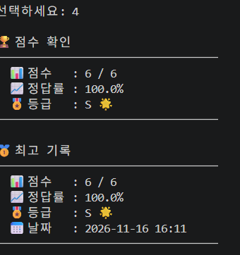
